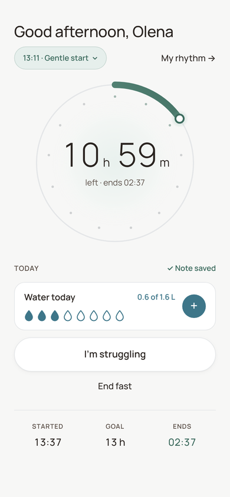
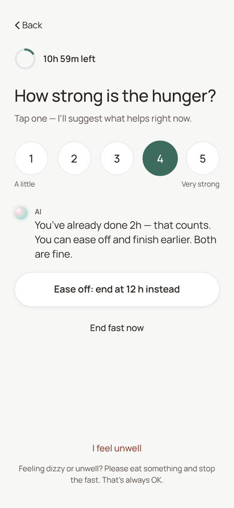
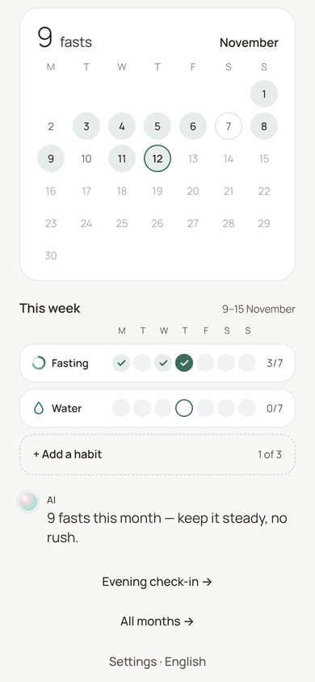
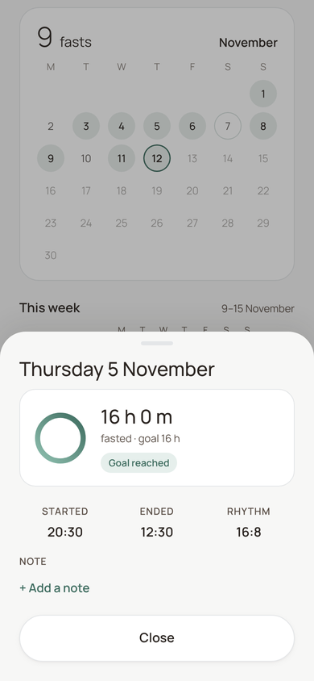

# Zvykny — a calm companion for intermittent fasting

**Live test build:** https://olhakachmar-lab.github.io/zvykny/

Zvykny is a mobile web app (PWA) for women 30–55 who want to try intermittent fasting gently, without pressure or "streak" guilt. This repository holds the **test build** used in a multi-day usability study (diary study): participants install it on their phones and use it for 3–4 days.

Designed and researched by **Olha Kachmar**: business analysis, UX research, UI design and the design system. Built from the Figma prototype into a working PWA.

  
  
  
  

## What it does

- **Gentle onboarding**: goals, life stage, a fixed safety check (under 18, pregnancy, eating disorder history, diabetes medication → a kind exit screen), dinner time, and an optional name.
- **Real fasting timer**: choose a rhythm (13:11, 14:10, 16:8; 18:6 unlocks after 7 fasts) and when you last ate. The ring keeps the correct time even when the phone is locked.
- **"I'm struggling"**: a 1–5 hunger scale with tips, "remind me in 20 min", "ease off" and "end gently". "I feel unwell" always stops the fast safely.
- **No punishment**: any fast of 10 h or more counts. Shorter days simply have no circle — nothing ever resets.
- **Your rhythm**: a monthly calendar built from real data, a week view, up to 3 habits (water, no sweets, 7,000 steps, protein, no alcohol), an evening check-in and simple insights.
- **Day log**: tap any day to see when you fasted, how long, the moments you logged, habits and your own note.
- **Notes**: a quiet "+ Note" on Home for today, editable for any past day.
- **Calendar reminders**: adds a daily event with alerts at the start and end of the fast to the phone's own calendar.
- **Ukrainian and English**, picked automatically from the phone's language and switchable at any time. The Ukrainian version addresses the user by name in the vocative case (Олена → Олено).
- **Private by design**: no accounts and no server. All data stays on the user's phone. Participants share their log with the researcher themselves (Settings → "Send my log to the researcher").

## How it's built

| Area | Choice |
|---|---|
| Stack | Plain HTML, CSS and JavaScript, no frameworks and no build step |
| Offline | Service worker that fetches from the network first, so updates reach testers, and falls back to the cache offline |
| Data | `localStorage` on the device |
| Fonts | Manrope, self-hosted (Latin and Cyrillic) |
| Hosting | GitHub Pages |

### Files

| File | What it is |
|---|---|
| `index.html` | App shell and splash animation |
| `styles.css` | Design tokens and components (from the Figma design system) |
| `texts.js` | **All texts in both languages.** Edit words here. |
| `app.js` | Screens, timer, calendar and logic |
| `sw.js` | Offline support |
| `manifest.webmanifest` | App name, icon and colours for "Add to Home Screen" |

## Try it

1. Open the live link on your phone, in Safari on iPhone or Chrome on Android.
2. Add Zvykny to your home screen:
   - **iPhone:** Share → Add to Home Screen.
   - **Android:** ⋮ → Install app.
3. Open it from the home screen.

Add `?demo=1` to the link, then go to Settings → "Demo: fill with sample data" to see three weeks of history.

## Notes

Wellness guidance, not medical advice. This is a research prototype, not a medical device.
